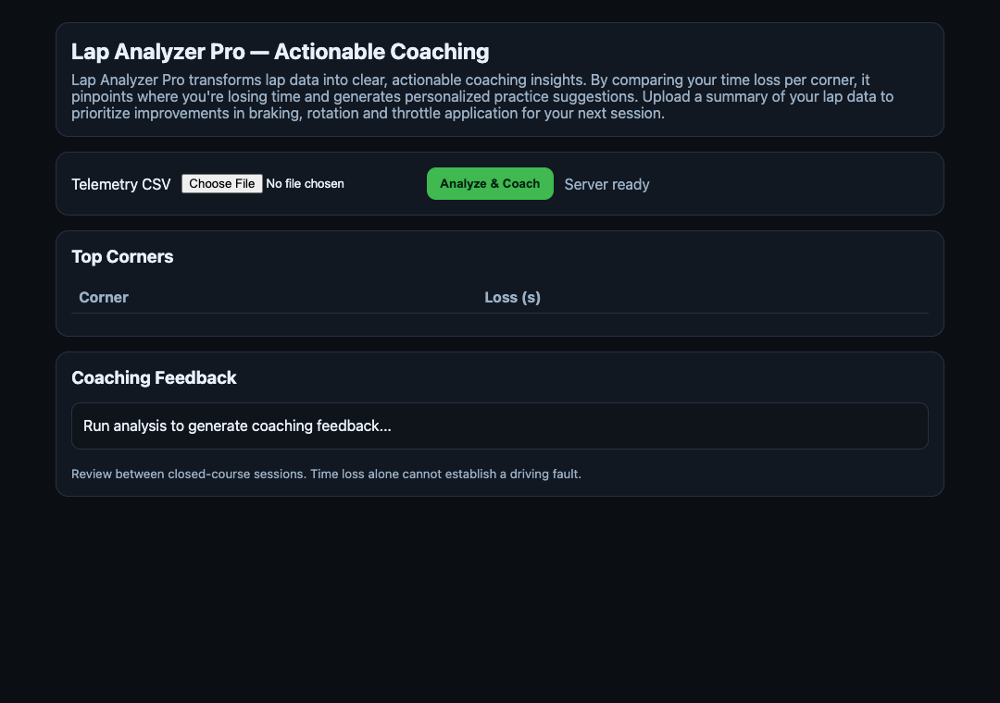
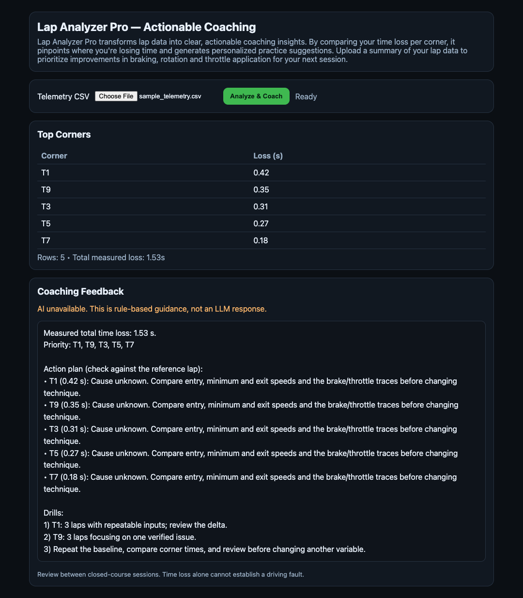
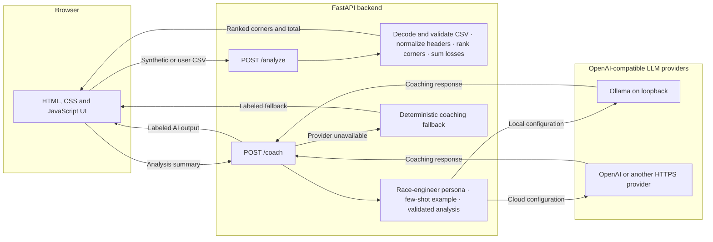

# Lap Analyzer Pro

Lap Analyzer Pro is a local motorsport coaching application. Upload a CSV of corner time losses against a reference lap to see the largest losses, get an ordered action plan, and review three practice drills between closed-course sessions. It uses Ollama by default, supports OpenAI-compatible HTTPS providers, and shows labeled rule-based guidance if inference is unavailable.

## Application screenshots

The running app before and after processing the included synthetic CSV. The results screen shows the five ranked corners, the measured total of 1.53 seconds, and the labeled coaching fallback.





## Windows: one-click start

1. Install Python 3.11+ (3.12 recommended) from [python.org](https://www.python.org/downloads/windows/) and [Ollama](https://ollama.com/download). These prerequisites are not bundled.
2. Clone the repository or extract the release ZIP into a regular folder. Double-click `Start_LapAnalyzer_Ollama.bat` from that folder.
3. The launcher finds Python, creates a local virtual environment, installs dependencies when the dependency manifest changes, reuses or starts Ollama, and downloads the selected model if needed. The initial package/model downloads require internet and can be large. It opens the browser only after the server starts.
4. Upload `sample_telemetry.csv` and click **Analyze & Coach**. Keep the server console open. Press Ctrl+C there to stop the backend.

The default web address is http://127.0.0.1:8000/. If the browser does not open automatically, visit that address once the console reports startup. Do not double-click the HTML directly. If Windows blocks downloading batch files, inspect the script in a text editor and use the manual startup below rather than disabling security protection.

`Start_LapAnalyzer_MIN.bat` is a compatibility launcher that skips Ollama preparation; an already configured model can still be used. `start_windows.bat` is an alias for the full launcher.

## macOS / Linux

Install Python and Ollama first. From the extracted folder:

```sh
chmod +x start_macos_linux.command
./start_macos_linux.command
```

Or start manually:

```sh
python3 -m venv .venv
.venv/bin/python -m pip install -r requirements.txt
.venv/bin/python launch.py
```

Windows manual setup (PowerShell opened in the extracted project directory):

```powershell
py -3 -m venv .venv
.\.venv\Scripts\python.exe -m pip install -r requirements.txt
.\.venv\Scripts\python.exe launch.py
```

If `py` does not work, use the actual installed Python executable or the batch launcher's automatic lookup. No activation script, PATH modification, or administrator access is needed to use an existing venv. Run `launch.py --skip-ollama --no-browser` to skip model preparation and browser opening. To start only the web server, run `python -m uvicorn main:app --host 127.0.0.1 --port 8000` from the project with the environment's Python.

## Data handling and configuration

The launcher binds to loopback. The application checks the host and the origin of browser submissions and bounds request bodies before parsing. Keep it on your machine, since this local MVP has no user authentication. CSV input must be valid UTF-8 and no larger than 2 MB.

Defaults work locally without an API key. To customize them, copy `.env.example` to `.env` and edit it. Existing environment variables override the file.

| Variable | Default | Purpose |
| --- | --- | --- |
| `OPENAI_BASE_URL` | `http://127.0.0.1:11434/v1` | Ollama's OpenAI-compatible endpoint |
| `COACH_MODEL` | `llama3.1:8b-instruct-q4_K_M` | Meta Llama 3.1 8B hosted by Ollama |
| `OPENAI_API_KEY` | empty | Required for a remote HTTPS provider |
| `COACH_TIMEOUT_SECONDS` | `180` | Model call timeout |
| `APP_PORT` | `8000` | Port used by launcher |
| `ALLOW_FILE_ORIGIN` | `0` | Optional legacy `file://` UI compatibility (not recommended) |

To use OpenAI instead of Ollama, set the base URL to `https://api.openai.com/v1`, choose an available model such as `gpt-4o-mini`, and provide your API key in `.env` or your environment. This sends the total, top eight corner summaries, and any notes attached to those corners to the cloud provider and may incur costs. The providers are alternatives, not simultaneous models. The fallback is local Python logic, not a generative model. Never commit your `.env`.

If a model is missing or times out, the UI explicitly labels its deterministic fallback. For a live AI demonstration, verify the result includes `AI-generated` and the model name. `GET /health` checks the backend configuration, not whether inference is working. Check `ollama list` or open http://127.0.0.1:11434/api/tags to see installed models. If port 11434 is already serving Ollama, do not start another instance.

## Input and processing

```csv
Corner,TimeLoss
T1,0.42
T3,0.31
T5,0.27
T7,0.18
T9,0.35
```

`TimeLoss` is nonnegative seconds relative to an already established reference lap. Use one row per corner or segment; a total across overlapping segments is not meaningful. The sample has five corners, 1.53 seconds of measured loss, and T1 as the largest loss. `sample_telemetry_with_notes.csv` is an earlier sample with optional observations. Notes may inform the coach but are not displayed as tags in the UI. Both samples are synthetic and contain corner labels, made-up losses, and optional example observations. The current MVP **does not ingest raw CAN, GPS, brake or throttle streams or calculate reference-lap deltas from them**. That requires a separate preprocessing pipeline. Time loss alone cannot establish the driving fault or guarantee recoverable lap time.

## Technical architecture



- **Frontend:** `lap_analyzer_pro.html`, HTML/CSS and vanilla JavaScript; uses Fetch with JSON, renders corner losses and coaching text.
- **Backend:** Python, FastAPI, Uvicorn, CSV parsing, Pydantic request validation and HTTPX model requests. Ranks the top eight corners and totals all measured losses.
- **Prompt engineering:** Persona sets the model as a professional race engineer. Few-shot demonstration provides an example input and expected English response. New constraints in recovery encourage honest uncertainty and conservative practice drills rather than unsupported exact driving targets.

| Endpoint | Purpose |
| --- | --- |
| `GET /` | Serves the UI from the backend (same origin) |
| `GET /health` | Backend health and configured provider/model |
| `POST /analyze` | JSON `{"csv_text":"..."}` or multipart `file`; returns ranked corners, total and count |
| `POST /coach` | Accepts analysis response; returns coaching text, source and model or fallback warning |
| `GET /docs` | Interactive FastAPI endpoint documentation |

## Testing and demonstration

From the project environment:

```sh
python -m unittest discover -s tests -v
```

All 15 tests passed locally on macOS with Python 3.12. The one-click macOS launcher was verified from a clean directory against a loopback mock provider. The automated suite covers CSV validation, request size and origin checks, the persona and few-shot message sequence, provider authentication, and fallback behavior. It uses HTTP mocks and needs no model or API key. The repository includes a GitHub Actions matrix for Linux, macOS, and Windows, with launcher checks. The hosted matrix checks launcher entry points and runs the automated suite. A real Ollama model, real OpenAI inference, and full Windows launcher startup remain unverified. For a real inference smoke test, start the full launcher, upload the CSV, and verify that the source is AI-generated. Advice is for review between closed-course sessions, not real-time driving commands.

For troubleshooting, read the startup console and check `/health`. If port 8000 is occupied, change `APP_PORT` in `.env` and restart. If the previous virtual environment is invalid, rename `.venv` and let the launcher recreate it. If Ollama cannot start, inspect `ollama.log` (when created), ensure Ollama is installed, and check that the configured model is listed.

## Repository notes

`the private recovery notes` identifies recovered and reconstructed files, changes, and test limitations. The superseded snapshot is retained in the private recovery intake because its earlier browser and server code is obsolete. No license was specified by the owner; add an appropriate license before distributing if desired. No model weights, virtual environment, personal filesystem paths, or real API keys are included.
